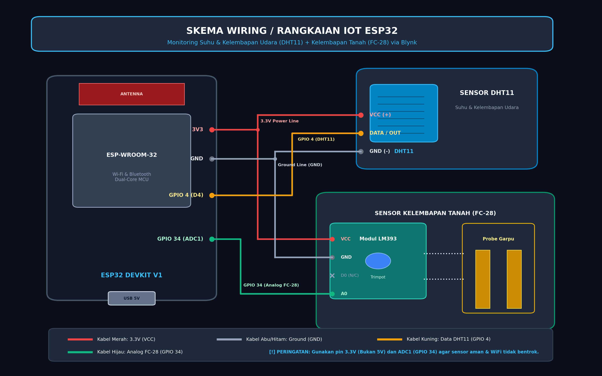

# Sistem Monitoring Suhu, Kelembapan Udara, dan Kelembapan Tanah Berbasis IoT (ESP32 + Blynk)

[](https://www.espressif.com/)
[](https://www.arduino.cc/)
[](https://blynk.cloud/)
[](https://en.wikipedia.org/wiki/Wi-Fi)
[](LICENSE)

Proyek Internet of Things (IoT) modern untuk pemantauan parameter mikroklimat lingkungan dan kelembapan tanah secara *real-time*. Sistem ini menggabungkan performa pemrosesan mikrokontroler dual-core **ESP32**, pembacaan presisi dari sensor **DHT11** dan **Soil Moisture FC-28**, serta visualisasi analitik interaktif melalui ekosistem **Blynk.Console (Web)** dan **Blynk Mobile App**.

---

## 🛠️ Tech Stacks & Architecture

Proyek ini dibangun menggunakan kombinasi perangkat keras teruji, pustaka (*libraries*) berkinerja tinggi, dan platform IoT berbasis *cloud*:

| Kategori | Teknologi / Komponen | Peran & Deskripsi |
|---|---|---|
| **Microcontroller Unit (MCU)** | **ESP32 DevKit V1 (30-pin)** | Dual-core Tensilica Xtensa 32-bit LX6, frekuensi hingga 240 MHz, ADC1 12-bit terintegrasi |
| **Sensing Elements** | **DHT11** | Sensor digital untuk membaca suhu (°C) dan kelembapan udara (% RH) |
| | **FC-28 Soil Moisture Sensor** | Sensor kelembapan tanah konduktif dengan modul komparator tegangan LM393 |
| **IoT Platform & Cloud** | **Blynk IoT 2.0 (Blynk.Console)** | Layanan *cloud broker*, penyimpanan telemetri data, dan manajemen perangkat IoT |
| **Firmware & Language** | **Embedded C / C++ (Arduino Core)** | Bahasa pemrograman utama dengan pengelolaan memori rendah (*low-overhead*) |
| **Communication Protocols** | **Wi-Fi 802.11 b/g/n (2.4 GHz)** | Jalur transmisi nirkabel jarak jauh ke router internet |
| | **TCP/IP & WebSockets** | Protokol komunikasi dua arah antara firmware ESP32 dan server Blynk Cloud |
| | **1-Wire Digital & Analog ADC** | Protokol komunikasi sensor DHT11 (GPIO 4) dan sampling ADC1 (GPIO 34) |
| **Core Libraries** | **BlynkSimpleEsp32** | Pustaka komunikasi dan sinkronisasi status ke cloud Blynk |
| | **BlynkTimer** | Manajemen *non-blocking multitasking* untuk penjadwalan pembacaan sensor |
| | **Adafruit DHT & Unified Sensor** | Pustaka ekstraksi sinyal data digital sensor DHT11 |
| **Development Tools** | **Arduino IDE 2.x / Antigravity IDE** | Lingkungan pengembangan, kompilasi kode, dan *serial monitoring* |
| | **Git & GitHub** | Sistem kontrol versi (*version control*) dan repositori kode sumber |

---

## 🚀 Apa yang Dihasilkan Proyek Ini?

Sistem ini menghasilkan sebuah solusi monitoring cerdas (*smart agriculture & plant monitoring*) yang andal:
1. **Pemantauan Suhu Udara (°C):** Mengukur suhu lingkungan secara berkala dengan rentang 0 - 50 °C.
2. **Pemantauan Kelembapan Udara (%):** Mengukur kadar air di udara sekitar dengan rentang 20% - 90% RH.
3. **Pengukuran Kelembapan Tanah (%):** Menghitung saturasi air dalam tanah dari 0% (kering total) hingga 100% (sangat basah/tergenang) melalui algoritma pemetaan ADC (*mapping & constraint*).
4. **Dashboard Visual Multi-Platform:** Menampilkan data secara langsung pada Web Browser (**Blynk.Console**) dan Smartphone (**Android / iOS**).
5. **Mekanisme Auto-Reconnect Cerdas:** Sistem secara otomatis mendeteksi status jaringan. Jika koneksi Wi-Fi terputus, firmware akan melakukan *retry reconnect* tanpa menghentikan pembacaan lokal dan tanpa risiko *watchdog reset* (*freeze*).

---

## 🔌 Skema Rangkaian dan Perkabelan

Berikut visualisasi diagram perkabelan sistem beresolusi tinggi:



*(File vektor interaktif tersedia di [skema_rangkaian.svg](skema_rangkaian.svg) jika ingin dibuka melalui browser).*

### Tabel Sambungan Pin (Wiring Diagram)

| Modul / Sensor | Pin Sensor | Pin ESP32 | Keterangan & Warna Kabel |
|---|---|---|---|
| **DHT11 (4-Pin / Cirkit)** | **Pin 1 (VCC)** | **3V3** | Daya 3.3V (Kabel Merah) |
| | **Pin 2 (DATA)** | **GPIO 4 (D4)** | Data digital 1-wire (Kabel Kuning) |
| | **Pin 3 (NC)** | *Dikosongkan* | Tidak dihubungkan |
| | **Pin 4 (GND)** | **GND** | Ground (Kabel Hitam / Abu-abu) |
| *(Jika DHT11 3-Pin)* | VCC, GND, DATA | 3V3, GND, GPIO 4 | Sama persis (VCC ke 3V3, GND ke GND, OUT ke GPIO 4) |
| **FC-28** (Kelembapan Tanah) | VCC | **3V3** | **Wajib 3.3V** demi keamanan pin ADC (Kabel Merah) |
| | GND | **GND** | Ground (Kabel Hitam / Abu-abu) |
| | A0 (Analog Out) | **GPIO 34 (D34)** | Input ADC1 ESP32 (Kabel Hijau) |
| | D0 (Digital Out) | *N/C* | Tidak disambungkan |
| **Probe Besi FC-28** | 2 Pin Header | Pin Input LM393 | Kabel penghubung probe garpu ke modul driver |

### Catatan Teknis Krusial

> [!IMPORTANT]
> 1. **Pemilihan Pin ADC1 (GPIO 34):** ESP32 memiliki dua kelompok ADC (ADC1 dan ADC2). Saat fitur Wi-Fi aktif (seperti pada transmisi Blynk), seluruh pin pada **ADC2 dinonaktifkan** oleh subsistem Wi-Fi ESP32. Karena itu, sensor analog **wajib menggunakan pin ADC1** (GPIO 32, 33, 34, 35, 36, 39). Pada proyek ini digunakan **GPIO 34**.
> 2. **Tegangan Catu Daya 3.3V:** Sensor FC-28 dan DHT11 wajib dihubungkan ke rel tegangan **3V3**, bukan 5V/VIN. Batas toleransi input GPIO ESP32 adalah maksimal 3.3V. Memberi daya 5V pada FC-28 berisiko merusak pin GPIO ESP32 akibat lonjakan tegangan analog A0.

---

## 🌐 Panduan Lengkap Konfigurasi Blynk IoT (Blynk.Console)

Konfigurasi cloud dapat dilakukan langsung melalui browser di **[blynk.cloud](https://blynk.cloud/)**:


### Langkah 1: Buat Template Baru
1. Buka dashboard [blynk.cloud](https://blynk.cloud/).
2. Pada menu bilah kiri, klik **Developer Zone** (ikon kunci inggris) -> pilih tab **Templates**.
3. Klik tombol **+ New Template** (kanan atas), lalu isi parameter:
   - **Name:** `Monitoring Sensor`
   - **Hardware:** `ESP32`
   - **Connection Type:** `WiFi`
4. Klik **Done**.

### Langkah 2: Buat Datastreams (Virtual Pins)
Masuk ke tab **Datastreams** di dalam template yang baru dibuat, lalu buat 4 Datastream tipe **Virtual Pin** berikut:

| Nama Datastream | Virtual Pin | Tipe Data | Min | Max | Satuan | Deskripsi |
|---|---|---|---|---|---|---|
| **Suhu Udara** | `V0` | Double | 0 | 60 | °C | Suhu dari sensor DHT11 |
| **Kelembapan Udara** | `V1` | Integer | 0 | 100 | % | Kelembapan relatif udara DHT11 |
| **Kelembapan Tanah** | `V2` | Integer | 0 | 100 | % | Persentase kadar air tanah FC-28 |
| **Raw ADC Tanah** | `V3` | Integer | 0 | 4095 | - | Nilai mentah 12-bit ADC (untuk kalibrasi) |

### Langkah 3: Desain Web Dashboard
1. Buka tab **Web Dashboard** di halaman template.
2. Tarik (*drag & drop*) komponen widget dari panel kiri ke area tengah:
   - **Gauge 1:** Arahkan Datastream ke `Suhu Udara (V0)`, beri label `Suhu Udara (°C)`.
   - **Gauge 2:** Arahkan Datastream ke `Kelembapan Udara (V1)`, beri label `Kelembapan Udara (%)`.
   - **Radial Gauge 3:** Arahkan Datastream ke `Kelembapan Tanah (V2)`, beri label `Kelembapan Tanah (%)`.
   - **Chart Widget (Opsional):** Tambahkan Datastream V0, V1, dan V2 untuk melihat grafik tren data historis.
3. Klik tombol hijau **Save** di pojok kanan atas.

### Langkah 4: Buat Device & Dapatkan Auth Token
1. Di menu bilah paling kiri, klik menu **Devices** (ikon kubus).
2. Klik tombol **+ New Device** -> pilih opsi **From template**.
3. Pilih Template: **Monitoring Sensor**, lalu klik **Create**.
4. Salin 3 baris kredensial yang muncul pada panel **Device Info**:
   ```cpp
   #define BLYNK_TEMPLATE_ID   "TMPLxxxxxx"
   #define BLYNK_TEMPLATE_NAME "Monitoring Sensor"
   #define BLYNK_AUTH_TOKEN    "YourAuthToken"
   ```

---

## 💻 Panduan Instalasi dan Upload Program

### 1. Pemasangan Library di Arduino IDE
Pastikan pustaka berikut telah diinstal melalui menu **Sketch -> Include Library -> Manage Libraries...**:
* `Blynk` oleh Volodymyr Shymanskyy
* `DHT sensor library` oleh Adafruit
* `Adafruit Unified Sensor` oleh Adafruit
* Package board **esp32** oleh Espressif Systems pada **Boards Manager**.

### 2. Penyesuaian Kredensial pada Kode
Buka file [sensor_to_blynk.ino](sensor_to_blynk.ino), lalu perbarui kredensial template dan jaringan Wi-Fi Anda:

```cpp
/* Kredensial dari Blynk Console */
#define BLYNK_TEMPLATE_ID   "TMPLxxxxxx"
#define BLYNK_TEMPLATE_NAME "Monitoring Sensor"
#define BLYNK_AUTH_TOKEN    "YourAuthToken"

/* Jaringan Wi-Fi (Wajib 2.4 GHz) */
char ssid[] = "NAMA_WIFI_RUMAH_ANDA";
char pass[] = "PASSWORD_WIFI_ANDA";
```

### 3. Kalibrasi Sensor FC-28
Karakteristik sensor FC-28 membaca resistansi tanah secara terbalik (nilai ADC tinggi saat kering, dan rendah saat basah):
1. **Kondisi Kering (0%):** Biarkan probe di udara terbuka. Amati nilai mentah ADC pada Serial Monitor atau Datastream `V3` (umumnya berada pada rentang `3200` hingga `3800`).
2. **Kondisi Basah (100%):** Celupkan ujung probe garpu ke dalam segelas air. Amati nilai ADC (umumnya turun ke rentang `1200` hingga `1600`).
3. Sesuaikan konstanta berikut pada kode program:
   ```cpp
   const int SOIL_DRY_VALUE = 3500;
   const int SOIL_WET_VALUE = 1300;
   ```

### 4. Upload ke Board ESP32
1. Tancapkan kabel USB dari ESP32 ke komputer.
2. Di Arduino IDE, pilih board: **DOIT ESP32 DEVKIT V1** (atau **ESP32 Dev Module**).
3. Pilih port COM yang aktif di menu **Tools -> Port**.
4. Klik tombol **Upload** (panah ke kanan).
5. Buka **Serial Monitor** pada kecepatan baud `115200`. Status di Blynk.Console akan seketika berubah menjadi hijau (**Online**) dan seluruh gauge akan menampilkan data secara langsung.

---

## 📁 Struktur Berkas Repositori

```text
sensor_to_blynk/
├── .clangd               # Konfigurasi C++ language server
├── .gitignore            # Filter file lokal dan temporary
├── README.md             # Dokumentasi utama proyek & panduan lengkap
├── SKEMA_RANGKAIAN.md    # Dokumentasi analisis skema dan diagram alir
├── sensor_to_blynk.ino   # Kode sumber firmware Arduino ESP32
├── skema_rangkaian.png   # Ilustrasi skema perkabelan visual (PNG 3200x2000)
└── skema_rangkaian.svg   # Diagram skema vektor skalabel (SVG)
```
