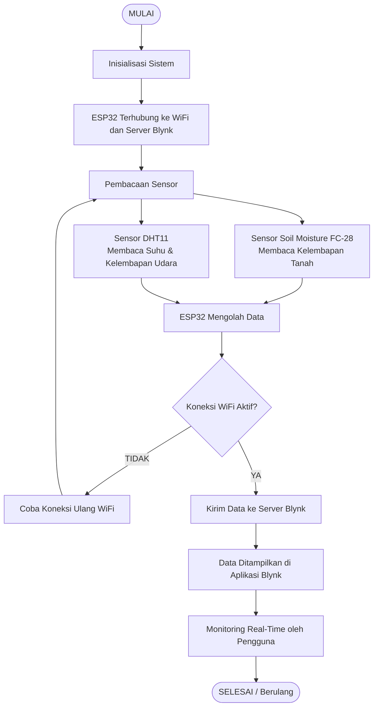

# Skema Rangkaian dan Panduan Sistem Monitoring IoT ESP32

Dokumen ini berisi panduan lengkap perancangan perangkat keras (skema rangkaian), penjelasan logika diagram alir, dan konfigurasi aplikasi Blynk IoT.

---

## 1. Kesesuaian dengan Diagram Alir (Flowchart)

Diagram alir sistem berjalan dengan urutan sebagai berikut:



---

## 2. Daftar Komponen yang Dibutuhkan

| No | Komponen | Jumlah | Keterangan |
|---|---|---|---|
| 1 | ESP32 Development Board | 1 unit | 30 pin atau 38 pin (NodeMCU ESP-32 / ESP-WROOM-32) |
| 2 | Sensor DHT11 | 1 unit | Sensor suhu dan kelembapan udara |
| 3 | Sensor Kelembapan Tanah FC-28 | 1 set | Probe logam + Modul Komparator LM393 |
| 4 | Breadboard / Project Board | 1 buah | Media perakitan rangkaian |
| 5 | Kabel Jumper (Dupont) | Secukupnya | Male to Male dan Male to Female |
| 6 | Resistor 10k Ohm (Opsional) | 1 buah | Pull-up resistor untuk DHT11 jika memakai sensor DHT11 versi 4-pin tanpa board modul |
| 7 | Kabel Micro-USB | 1 buah | Untuk upload program dan catu daya 5V |

---

## 3. Tabel Sambungan Kabel (Pinout Connection)

### A. Koneksi Sensor DHT11 ke ESP32

> **Catatan:** Modul DHT11 PCB biasanya memiliki 3 pin bertanda `+` (VCC), `-` (GND), dan `S` atau `OUT` (Data).

| Pin DHT11 | Pin ESP32 | Keterangan |
|---|---|---|
| VCC / `+` | 3V3 (3.3V) | Catu daya sensor (disarankan 3.3V) |
| GND / `-` | GND | Ground sistem |
| DATA / `S` / `OUT` | GPIO 4 (D4) | Jalur komunikasi data digital 1-wire |

*(Jika menggunakan DHT11 4-kaki tanpa PCB, pasang resistor 10k ohm antara pin VCC dan pin DATA sebagai pull-up resistor)*.

---

### B. Koneksi Sensor Soil Moisture FC-28 ke ESP32

Modul komparator FC-28 memiliki 4 pin: `VCC`, `GND`, `D0` (Digital Out), dan `A0` (Analog Out).

| Pin Modul FC-28 | Pin ESP32 | Keterangan |
|---|---|---|
| VCC | 3V3 (3.3V) | **Wajib 3.3V**, agar tegangan keluaran analog tidak melebihi batas toleransi pin ESP32 (3.3V) |
| GND | GND | Ground sistem |
| A0 (Analog Out) | GPIO 34 (D34) | Pin input ADC1 untuk pembacaan kadar air tanah |
| D0 (Digital Out) | Tidak disambung | Tidak dipakai (opsional jika hanya butuh logika ambang batas) |

> **PERINGATAN TEKNIS PENTING (Pemilihan Pin ADC ESP32):**
> ESP32 memiliki dua kelompok ADC: ADC1 dan ADC2. Ketika fitur WiFi diaktifkan (seperti pada Blynk), seluruh pin pada kelompok **ADC2 dinonaktifkan oleh driver WiFi**. Oleh karena itu, sensor analog **wajib menggunakan pin ADC1** (GPIO 32, 33, 34, 35, 36, 39). Pada proyek ini dipilih **GPIO 34**.

---

## 4. Ilustrasi Diagram Rangkaian (Gambar Skema)

Gambar skema rangkaian telah dibuat dalam resolusi tinggi dan format vektor di folder proyek:
- **File Gambar PNG:** [skema_rangkaian.png](file:///d:/sensor_to_blynk/skema_rangkaian.png) *(dapat langsung dibuka di Image Viewer Windows)*
- **File Gambar SVG:** [skema_rangkaian.svg](file:///d:/sensor_to_blynk/skema_rangkaian.svg) *(format vektor tajam tanpa pecah, dapat dibuka di browser seperti Chrome/Edge)*

```text
                   +------------------------+
                   |       ESP32 BOARD      |
                   |                        |
(3.3V Catu Daya)   | 3V3                GND | ----+ (Ground Bersama)
                   |                        |     |
(Data DHT11)       | GPIO 4                 |     |
                   |                        |     |
(Analog FC-28)     | GPIO 34                |     |
                   +------------------------+     |
                     |      |                     |
                     |      |                     |
       +-------------+      +--------------+      |
       |                                   |      |
       v                                   v      v
+-------------+                     +------------------+
| SENSOR      |                     | SENSOR FC-28     |
| DHT11       |                     | (Modul Driver)   |
|             |                     |                  |
| VCC  [3.3V] | <--- 3.3V           | VCC [3.3V]       | <--- 3.3V
| DATA [D4]   |                     | GND [GND]        | <--- GND
| GND  [GND]  | <--- GND            | A0  [GPIO 34]    |
+-------------+                     | D0  [N/C]        |
                                    +------------------+
                                             |
                                    +------------------+
                                    | Probe Besi FC-28 |
                                    | Ditancap ke      |
                                    | Tanah            |
                                    +------------------+
```

---

## 5. Konfigurasi Blynk IoT (Blynk 2.0)

Untuk menampilkan data pada aplikasi smartphone maupun Web Dashboard Blynk:

### Langkah 1: Buat Template Baru
1. Masuk ke situs **blynk.cloud**.
2. Masuk ke menu **Developer Zone** -> **Templates** -> **+ New Template**.
3. Beri nama: `Monitoring Suhu dan Tanah`.
4. Pilih Hardware: `ESP32`, Connection: `WiFi`.

### Langkah 2: Buat Datastreams
Masuk ke tab **Datastreams** di dalam Template, lalu tambahkan Datastream bertipe **Virtual Pin**:

1. **Suhu Udara**
   - Name: `Suhu Udara`
   - Pin: `V0`
   - Data Type: `Double`
   - Min: `0`, Max: `60`
   - Units: `°C`
2. **Kelembapan Udara**
   - Name: `Kelembapan Udara`
   - Pin: `V1`
   - Data Type: `Integer`
   - Min: `0`, Max: `100`
   - Units: `%`
3. **Kelembapan Tanah**
   - Name: `Kelembapan Tanah`
   - Pin: `V2`
   - Data Type: `Integer`
   - Min: `0`, Max: `100`
   - Units: `%`
4. **ADC Mentah Tanah (Opsional untuk kalibrasi)**
   - Name: `ADC Raw Tanah`
   - Pin: `V3`
   - Data Type: `Integer`
   - Min: `0`, Max: `4095`

### Langkah 3: Tambahkan Widget pada Web & Mobile Dashboard
- **Gauge Widget** untuk Suhu Udara (`V0`).
- **Radial Gauge / Level Widget** untuk Kelembapan Udara (`V1`).
- **Radial Gauge Widget** untuk Kelembapan Tanah (`V2`).
- **SuperChart / Value Display** untuk melihat grafik perkembangan data secara real-time.

---

## 6. Kalibrasi Nilai Sensor Kelembapan Tanah FC-28

Karakteristik sensor FC-28 bersifat terbalik (semakin basah tanah, semakin konduktif, sehingga tegangan analog dan nilai ADC semakin turun):

1. **Uji Kondisi Udara / Kering (0%):**
   - Biarkan probe FC-28 di udara terbuka tanpa disentuh air.
   - Amati Serial Monitor atau Datastream `V3`. Nilai ADC biasanya berkisar antara **3200 sampai 3800**.
   - Masukkan nilai ini ke konstanta `SOIL_DRY_VALUE` pada kode program.
2. **Uji Kondisi Basah / Air (100%):**
   - Celupkan ujung probe ke dalam segelas air (jangan mencelupkan modul sirkuit birunya).
   - Amati nilai ADC. Nilai biasanya turun ke kisaran **1200 sampai 1600**.
   - Masukkan nilai ini ke konstanta `SOIL_WET_VALUE` pada kode program.

---

## 7. Library Arduino IDE yang Perlu Diinstal

Sebelum melakukan kompilasi program, pastikan library berikut telah terpasang melalui **Sketch -> Include Library -> Manage Libraries**:
1. **Blynk** oleh Volodymyr Shymanskyy (versi terbaru).
2. **DHT sensor library** oleh Adafruit.
3. **Adafruit Unified Sensor** oleh Adafruit (dependensi untuk DHT).

